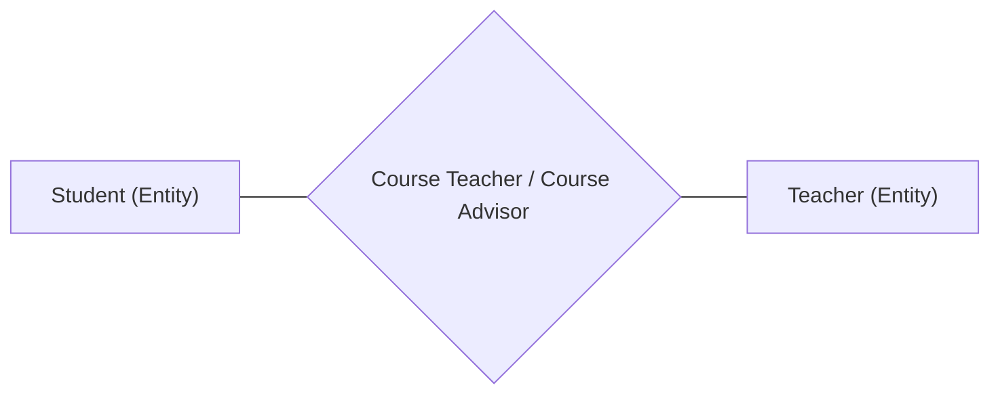

# DBS - 2 (M): Course Overview, Database Design Concepts & Syllabus Roadmap

## Overview
Subject check: Database Systems

This introductory class (effectively the students' first lecture with this teacher) provides a high-level roadmap of the Database Systems course, explains how the syllabus and labs are split between the two instructors, and introduces the core concepts the teacher will cover starting next class. Rather than diving directly into Chapter 6 (which depends on earlier chapters), the teacher walks through why databases replace file systems, how database design begins with requirement analysis, and previews the major models and topics ahead: Relational Model, ER Diagrams, Normalization, Concurrency Control, Transactions (ACID), and Database Security.

## Topic Map
- Course Structure, Resources & Syllabus Split
  - Two-teacher coordination & chapter dependencies
  - ConnectCSE portal & course materials/slides
  - Textbook: Silberschatz (7th Edition) & open external sources
  - Chapter allocation (Chapters 1–4 vs. Chapters 6, 7, 9; Chapter 5 skipped)
  - Lab rotation (7 cycles per teacher)
- File Systems vs. Databases (Recap)
  - Problems with file systems (atomicity, duplication, redundancy, inconsistency, security, difficult access)
- Database Design & Requirement Analysis
  - Role of a database designer
  - Identifying users/stakeholders (Company & RUET examples)
  - Gathering & analyzing requirements
- Core Database Terminology & Models
  - Key terms: Entity, Relation, Tuple, Attribute
  - Model selection: Relational Model, ER Diagram, Object-Oriented Model (not covered)
  - Relational Database (tabular format, `Student` & `Teacher` table examples, keys)
  - ER (Entity-Relationship) Diagrams (`Student`–`Teacher` examples, weak entity/relation, total participation, aggregation)
- Normalization (Chapter 7)
  - Removing data redundancy (central university database example)
  - Normal forms (1NF, 2NF, 3NF, BCNF)
- Concurrency Control & Transactions ("Chapter 9")
  - Concurrency control (bank account withdrawal race condition example: 1000 − 100 − 200)
  - Transaction atomicity & failure handling (ATM cash withdrawal failure example)
  - Serializability & transaction protocols
  - ACID properties (Atomicity, Consistency, Isolation, Durability)
- Database Security & Authorization (Time Permitting)
  - Access control & authorization rules
- Co-Teacher's Portion Preview
  - Chapter 1 (Intro), Chapter 2 (Relational Model), Chapter 3 (SQL), Chapter 4 (Joins & Relational Algebra)
  - SQL compared to C, C++/Java, and Assembly

## Detailed Notes

### 1. Course Structure, Textbook & Chapter Allocation
- **Two-Teacher Coordination:** The course is jointly taught by two instructors (this teacher and a co-teacher). Because later chapters depend on understanding earlier chapters, the instructors must coordinate the sequence carefully.
- **Textbook & Materials:**
  - Primary textbook: *Database System Concepts* by Silberschatz (**7th Edition**).
  - Teaching style generally follows the book's chapter flow and book-based slides, though some topics are taught in the instructors' own way.
  - **Open Sources:** Students are free to study from any resource (textbook, YouTube lectures, etc.); reading strictly from the book is not mandatory, as long as the topic sequence is followed.
- **Chapter Split:**
  - **Co-teacher's chapters:**
    - **Chapter 1:** Introduction
    - **Chapter 2:** Relational Model
    - **Chapter 3:** SQL Queries (taught early by the co-teacher because students need SQL for the lab)
    - **Chapter 4:** Join operations & Relational Algebra
  - **Skipped:** **Chapter 5** is not taught in this course.
  - **This teacher's chapters (starting next class):**
    - **Chapter 6:** Database Design (ER Diagrams)
    - **Chapter 7:** Normalization
    - **"Chapter 9" (as stated by the teacher):** Transactions & Concurrency Control *(note: in Silberschatz 7th ed., Transactions and Concurrency Control are later chapters, Ch. 17–18; "Chapter 9" likely reflects local slide/syllabus numbering or an earlier reference)*
    - **Optional (if time permits):** Database Security & Authorization.

---

### 2. Why Databases Are Needed (Recap vs. File Systems)
Traditional file systems suffer from major limitations:
- **Atomicity problems** (partial updates on failure)
- **Data duplication & redundancy** (same data stored repeatedly)
- **Inconsistency** (copies of data not matching)
- **Security issues** (lack of fine-grained access control)
- **Access difficulty** (cannot easily query or retrieve specific data)

Databases are used as the solution to all of these problems.

---

### 3. Database Design & Requirement Analysis
When asked to design a database as a database designer, the **first and most important step** is **Requirement Analysis**:
1. **Identify the organization/domain** you are designing for (e.g., a company or RUET).
2. **Identify all user groups (stakeholders):**
   - *Company example:* Admin, Staff, End Users (customers/users of the software or website).
   - *RUET example:*
     - **Administrative / Governing Body (Admin / Super Admin):** Has distinct requirements and sensitive data (e.g., information accessible only to the VC, which might not even be stored for general access).
     - **Teachers**
     - **Technical Officers** (office staff)
     - **General Staff** (e.g., cleaners, etc.)
     - **Students**
3. **Interview users & analyze requirements:**
   - Ask each user group what they need.
   - Determine which information is essential vs. optional (can be omitted).
   - Determine how different pieces of information relate to one another.
4. Design the database structure based on this analysis.

---

### 4. Core Terminology & Database Models
Before designing, key terms must be understood: **Entity**, **Relation**, **Tuple**, and **Attribute**.

After collecting data/requirements, the designer must select an appropriate **model**:
1. **Relational Model** *(covered in course)*
2. **ER (Entity-Relationship) Diagram / Extended ER** *(covered in course)*
3. **Object-Oriented Model** *(mentioned, but **not** taught/used in this course)*

#### A. Relational Database Model
- Stores information in **tabular form** (each table is called a **Relation**).
- **Worked Board Example (`Student` and `Teacher` tables):**

  **`Student` Table:**
  | ID | Name | CGPA | Department | *(other possible: Series, Section, ...)* |
  |---|---|---|---|---|
  | 1 | A | 3.5 | CSE | ... |
  | 2 | B | 3.9 | CSE | ... |

  **`Teacher` Table:**
  | T_ID | Name | Designation | Department |
  |---|---|---|---|
  | T1 | ABC | Lecturer | CSE |
  | T2 | XYZ | Assistant Professor *(also mentions Associate Prof., Professor)* | EEE |

  *(Additional tables can exist for Staff, Admin, etc.)*

- **Relating Tables via Keys:**
  - Tables are interrelated so queries can span across them.
  - Both `Student` and `Teacher` share a `Department` attribute.
  - *Query example:* Suppose you want the `ID` and `Name` of students in the CSE department who take a course with teacher `T1`. The `Student` table alone does not contain `T1`'s information; that resides in `Teacher`. Thus, tables must be linked using **keys** (different types of keys will be taught in the Relational Model).

#### B. ER (Entity-Relationship) Diagram
- Visualizes entities and how they relate to one another.
- **Worked Board Example:**

- **Intuitive examples:**
  - **Course Teacher:** Not every teacher teaches a given course to a student, so a `Course Teacher` relationship links specific `Student` and `Teacher` entities.
  - **Course Advisor:** Out of ~20 teachers in CSE, only one specific teacher serves as a student's advisor (`Student–Advisor` relationship).
- **Advanced Chapter 6 ER concepts previewed:**
  - Identifying relationships among given data
  - **Weak entity sets** and **weak relationships**
  - **Total participation**
  - **Aggregation**

---

### 5. Normalization (Chapter 7)
- **Purpose:** Remove **redundant data** (unnecessary repetition / *বাহুল্য*) from tables.
- **Intuitive Example:** Suppose a university has a single central database (instead of separate department databases) holding all teachers, students, and departments. If you query only for the CSE department, extra/redundant data across tables wastes space and causes anomalies. Normalization eliminates unnecessary/duplicate storage.
- **Normal Forms to be taught:**
  - **1NF** (First Normal Form)
  - **2NF** (Second Normal Form)
  - **3NF** (Third Normal Form)
  - **BCNF** *(spoken as "CNF" in the recording; note: standard syllabus progression after 3NF is BCNF)*

---

### 6. Concurrency Control & Transactions ("Chapter 9")

#### A. Concurrency Control
- **Meaning:** Managing **concurrent** access when multiple users read/modify the same data at the same time.
- **Worked Example (Bank Account Withdrawal Race Condition):**
  - Initial account balance: **1000 Taka**.
  - **User A** and **User B** access the account **at the exact same time**:
    - User A debits **100 Taka** $\rightarrow 1000 - 100 = 900\text{ Taka}$.
    - User B simultaneously debits **200 Taka** (seeing the stale balance of 1000 in an uncontrolled/file-like system) $\rightarrow 1000 - 200 = 800\text{ Taka}$.
  - **Problem:** The system records the final balance as **800 Taka**, whereas the **true balance must be**:
    $$900 - 200 = 700\text{ Taka}$$
  - **Solution:** Enforce ordered execution: User A completes its entire transaction first; only after A finishes can User B execute. Concurrency control defines protocols for which user/operation runs first and how concurrent access is synchronized.

#### B. Transactions & Failure Handling
- **Worked Example (ATM Withdrawal Failure):**
  - You go to an ATM booth, insert your card, enter your password/PIN, and enter an amount to withdraw.
  - Suppose your account is **debited**, and immediately afterward the **system fails** (e.g., power outage).
  - Result: Money is deducted from your account, yet you never received the cash. This is an **incomplete transaction**.
- **Core Rule:** In a database, **partial transactions are forbidden**. A transaction must follow an **all-or-nothing** rule: either it completes **100%**, or it does **not happen at all** (rolled back).
- **Topics covered:** Transaction protocols, designing transactions to avoid failure anomalies, and making transactions **serializable**.

#### C. ACID Properties
To prevent concurrency and failure risks, database transactions maintain the four **ACID** properties:
- **A**: **Atomicity** (all-or-nothing execution)
- **C**: **Consistency** (database moves from one valid state to another)
- **I**: **Isolation** (concurrent transactions do not interfere with each other)
- **D**: **Durability** (committed changes survive system failures)

---

### 7. Database Security & Authorization (Optional / Time Permitting)
If time remains at the end of the term, the teacher will cover:
- Who should be granted access to which parts of the database and who should be restricted.
- How **authorization** works.
- How **database security** is maintained.

---

### 8. Preview of Co-Teacher's Portion (SQL & Relational Algebra)
- **SQL (Structured Query Language)** (Chapter 3):
  - Comparison with languages students have already learned:
    - **C** $\rightarrow$ Structured programming language
    - **C++ / Java** $\rightarrow$ Object-Oriented Programming (OOP) languages
    - **Assembly** $\rightarrow$ Low-level assembly language
    - **SQL** $\rightarrow$ Structured Query Language for interacting with databases
  - **Capabilities:** Creating databases, creating tables, inserting data, deleting, updating, editing, and querying data, used directly in the lab.
- **Relational Algebra & Joins** (Chapter 4): Various join operations and relational algebra (interrelated with SQL and the relational model).

## Exam / Important Points
- **Chapter Dependencies:** Later chapters depend heavily on earlier ones; missing early classes will make later chapters hard to follow.
- **Requirement Analysis:** Highlighted by the teacher as the **most important part** of database design.
- **All-or-Nothing Transactions:** Partial transactions are never allowed in a database; remember both the **bank balance concurrency example** ($1000 - 100 - 200 = 700$, not $800$) and the **ATM failure example**.
- **ACID Properties:** Explicitly named and spelled out (Atomicity, Consistency, Isolation, Durability) as essential to avoiding transaction risks.
- **Chapter 5:** Explicitly noted as **not taught** in this course.

## Announcements & Logistics
- **ConnectCSE:** All students who are not yet connected to **ConnectCSE** must join immediately; all slides and study materials will be uploaded there.
- **Textbook:** Silberschatz, *Database System Concepts*, **7th Edition** (external resources like YouTube are also allowed).
- **Lab Schedule / Rotation:** In response to a student's question at the end of class, the teacher clarified that the **co-teacher will handle both lab sections for the first 7 cycles**, and **this teacher will handle both sections for the next 7 cycles**.

## Open Questions / Unclear Parts
- **00:00–00:15:** The recording starts mid-sentence as the teacher discusses section scheduling and "7 cycles" (presumably explaining the new multi-teacher split across sections).
- **01:28–02:15:** Brief pause with background classroom/hallway noise and someone briefly speaking near the door/phone; no lecture content was missed.
- **15:46:** The teacher lists normal forms as "1st NF, 2nd, 3rd, CNF"; "CNF" is ambiguous in audio and almost certainly refers to **BCNF** (Boyce–Codd Normal Form).
- **16:08:** The teacher refers to Transactions & Concurrency Control as **"Chapter 9"**; in Silberschatz 7th Edition, these topics appear in later chapters, so the numbering likely refers to the department syllabus or slide deck numbering.
