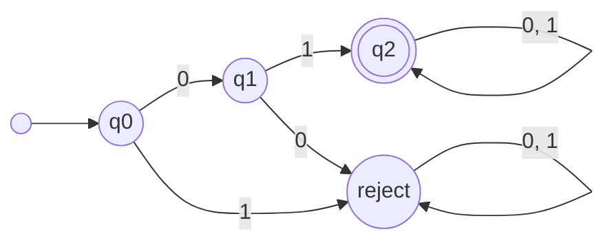

# TOC - 1: Introduction to Theory of Computation, Automata Hierarchy, and DFA Basics

## Overview
This introductory lecture for **CSE 3103: Theory of Computation (TOC)** introduces the three core pillars of the course (Finite Automata Theory, Computability Theory, and Complexity Theory) and explains why the course is essential for determining what can be physically computed and at what cost. Using compilers, Alan Turing's principle, and search engines as motivating examples, the teacher surveys the hierarchy of computational models and concludes with a worked example of designing a Deterministic Finite Automaton (DFA) for binary strings starting with `01`.

## Topic Map
- Course Scope & Purpose
  - Three Core Pillars: Finite Automata Theory, Computability Theory, Complexity Theory
  - Measuring Strength and Limitations of Computation
  - Alan Turing & the Turing Machine Principle
  - Connection to Programming Languages, Compilers, and Interpreters
- Computational Models & Hierarchy
  - Finite State Machines: DFA, NFA, $\varepsilon$-NFA
  - Non-Finite State Machines: Pushdown Automata (PDA), Context-Free Grammar (CFG), Context-Free Language (CFL), Context-Sensitive Language
  - Turing Machine (Computability) & Undecidability (Complexity)
  - Meaning of "Automaton / Automata"
- Deterministic Finite Automata (DFA)
  - 5 Components of a DFA
  - Worked Example: Binary Strings Starting with `01`
  - State Transition Diagram (STD) & Reject State
  - Preview of Language, String, and Alphabet
- Applications of Regular Expressions / Regular Languages
  - Document Search & Web Search Engines (e.g., Google)

## Detailed Notes

### 1. Course Scope and Core Objectives
The teacher introduced **CSE 3103: Theory of Computation** around three main pillars that will be studied across the semester:
1. **Finite Automata Theory**
2. **Computability Theory**
3. **Complexity Theory** (or Complexity Analysis)

**Why this course matters (core intuition):**
- Whenever a human thinks of an algorithm or computational idea ("I will do something like this"), it initially exists only in human thought. To bring an idea from thought into physical reality, we must know whether implementation is actually possible.
- **Role of Theory of Computation:** It measures the **strength and limitations** of any computation.
  - Note: While many human ideas are eventually realized or closely approximated over time, some problems are fundamentally impossible to implement physically.
  - **Computability Theory** measures whether a problem is actually *computable*: whether real-world machines can recognize/compute it.
  - **Complexity Theory** measures the *cost* required to bring a computable idea into physical reality.

### 2. Alan Turing's Principle & Historical Context
- The teacher referenced **Alan Turing** (and the prestigious Turing Award/Prize given for major scientific/computing innovations).
- **Turing's Core Principle:** If something arises in human thought and can be given physical existence, there must exist an equivalent **Turing Machine** for it.
  - Equivalently, if a Turing Machine can recognize your theory/idea, then it is possible to bring it into physical existence.
- **What "physical existence" means in this course:** We do not build full hardware in class; rather, we build a *short/scratch version* (abstract simulated model) on paper, which can then be converted into an actual machine or program.
- **Historical intuition:** In the earliest days of computing (basic arithmetic with early calculators/computers), people first tested on paper using simulated mechanisms/devices whether a computation was possible before building it physically.

### 3. Connection to Programming Languages & Compilers
- The teacher asked students to list languages they know: Machine Language, Assembly Language, C, C++, Python, Java, JavaScript, TypeScript, Ruby, Pascal, COBOL, Fortran (setting aside markup languages and web frameworks to focus on programming languages).
- **How programming languages work:** A language designer conceives syntax rules; for example, in C, `if (...)` takes a condition inside parentheses, and `{ ... }` encapsulates multiple lines (or can be omitted for a single line); `#include` includes header files; `else` and `for` each follow strict rules.
- **Recognizing a language:** Programming languages are recognized by a **Compiler** (or, in many cases, an **Interpreter**).
- If you design a new programming language in your mind, you need an equivalent compiler/interpreter. Theory of Computation determines whether such a language and its rules can be physically implemented.
- **Link to future coursework:** A later course, *Compiler Design* (which includes a lab), builds directly on these foundations to show how compilers actually construct and parse programming languages.

### 4. Computational Models & Machine Hierarchy
The teacher outlined the models covered in the course, noting their relative computational power (from weakest to strongest):

1. **Finite State Machines (Finite Automata Theory):**
   - **DFA** (Deterministic Finite Automata): weakest in expressive mechanism (note: all three finite automata models have equal recognition power, though DFA is the most restricted in transition rules).
   - **NFA** (Non-deterministic Finite Automata)
   - **$\varepsilon$-NFA** (Non-deterministic Finite Automata with $\varepsilon$-transitions)
2. **Non-Finite State Machines (more powerful):**
   - **Pushdown Automata (PDA)**: paired with:
     - **Context-Free Grammar (CFG):** Defines the formal grammar rules of a language (how a machine learns/recognizes syntax rules).
     - **Context-Free Language (CFL):** The language generated by a Context-Free Grammar.
     - *(Briefly mentioned: Context-Sensitive Language as another class.)*
3. **Turing Machine (Computability Theory):** The most powerful computational model in the hierarchy.
4. **Complexity Analysis:** Basic algorithm complexity analysis was already covered in the previous *Algorithms* course, so it will not be repeated at the introductory level. Instead, this course covers a more advanced topic: **Undecidable** problems (partially deferred from last semester).

- **Power Order (Weakest $\rightarrow$ Strongest):**
  $$\text{DFA} \rightarrow \text{NFA} \rightarrow \varepsilon\text{-NFA} \rightarrow \text{PDA} \rightarrow \text{Turing Machine}$$
- *(Note: The teacher remarked that when physically implementing models, each needs to be brought into a DFA; strictly speaking, this applies to finite automata models like NFA and $\varepsilon$-NFA, which can always be converted to an equivalent DFA, whereas PDAs and Turing Machines are strictly more powerful.)*

**What "Automata" means:**
- It does **not** mean "automation."
- Singular: **Automaton** (*অটোমেটন*); plural: **Automata**.
- Meaning: A device or mechanism used to illustrate and verify a theoretical computational concept.

### 5. Deterministic Finite Automata (DFA) & Worked Example
Each model (DFA, NFA, $\varepsilon$-NFA) has its own formal rules. A **DFA** is defined by **5 components**:
1. **Set of input symbols**
2. **Finite set of states**
3. **Transition function**
4. **Start state**
5. **Set of final states** (may contain one or multiple final states)

#### Worked Example: Binary Strings Starting with `01`
- **Goal:** Design a machine/program that recognizes all strings over $\{0, 1\}$ that **start with `01`**.
  - When a matching string is fed in, the machine accepts it (e.g., turns on an LED or outputs "Accepted").
- **Input symbols:** `0` and `1`.
- **Sample test cases:**
  - `01` $\rightarrow$ **Accepted**
  - `0` $\rightarrow$ **Rejected** (only `0`, missing `1`)
  - `010` $\rightarrow$ **Accepted**
  - `01001` $\rightarrow$ **Accepted**
  - Any string starting with `1` (e.g., `1...`) $\rightarrow$ **Rejected**

**States and State Transition Diagram (STD):**
- **States** (e.g., $q_0, q_1, q_2$) behave like nodes in a graph, with directed edges labeled by input symbols (including self-loops back to the same state).
- The graphical representation of the transition function is called a **State Transition Diagram (STD)**.
- **Step-by-step construction:**
  1. Start at the **start state** $q_0$.
  2. On input `0`, transition from $q_0 \rightarrow q_1$.
  3. From $q_1$, on input `1`, transition to $q_2$, which is the **final state** (drawn with a double circle). At this point, the prefix `01` has been seen.
  4. At $q_2$, any subsequent `0` or `1` keeps the machine in $q_2$ (self-loop on `0, 1`), because the string still started with `01`.
  5. **Satisfying DFA determinism rules:** Every state must have a transition for *every* input symbol (`0` and `1`), and no state can have multiple outgoing transitions for the same symbol:
     - At $q_0$, if input is `1`, transition to a **reject state** (trap state).
     - At $q_1$ (after seeing `0`), if input is `0` (meaning prefix `00`), transition to the **reject state**.
     - At the **reject state**, any further `0` or `1` loops back to the **reject state** (once rejected, it can never become accepted).

#### Preview of Key Terminology (from the example)
Although formal definitions will be given in later classes, the teacher illustrated three basic terms using this example:
- **Language:** The entire set of strings recognized/accepted by the machine (e.g., $\{01, 010, 01001, \dots\}$).
- **String:** A single element/member of the language (e.g., `01`, `010`).
- **Alphabet:** A single individual symbol that makes up a string (e.g., `0`, `1`).

### 6. Real-World Application: Searching & Regular Expressions
- **Document Search:** When searching inside a document by name, mobile number, or email suffix (e.g., `@gmail.com`), the search engine fetches and highlights all matching occurrences.
- **Web Search (e.g., Google):** When searching with specific words/tokens, Google retrieves all web pages containing those words.
- **Underlying Mechanism:** This pattern-matching and searching process is powered by **Regular Expressions** / **Regular Languages**, which will also be studied in this course.

## Exam / Important Points
- **DFA Rules (must always be checked when designing a DFA):**
  1. From every state, there must be a defined transition for **every** input symbol in the alphabet (cannot leave an input symbol undefined, e.g., missing `1` from $q_0$ or `0` from $q_1$; use a reject/trap state).
  2. From any single state, a single input symbol **cannot** go to more than one state (no non-determinism).
- Know the **5 components** of a DFA (set of input symbols, finite set of states, transition function, start state, set of final states) and how a final state is drawn (double circle).
- Understand the distinction between **Automaton** (a model/device to illustrate and test a theoretical concept) and **automation** (the teacher explicitly warned that "automata" does *not* mean automation).
- Remember the **hierarchy of machines** from weakest to strongest: $\text{DFA} \rightarrow \text{NFA} \rightarrow \varepsilon\text{-NFA} \rightarrow \text{PDA} \rightarrow \text{Turing Machine}$.

## Announcements & Logistics
- Attendance was called for Roll 1–60 at the beginning of class (`02:11–05:37`).
- The teacher warned students not to talk/chat during lectures.
- Today's class served purely as an introductory overview; detailed formal definitions and topics will begin from the next class.
- No class tests, assignments, deadlines, or reference books were announced.

## Open Questions / Unclear Parts
- `05:38–07:35`: Casual classroom chatter while adjusting the fans and AC; mostly background noise, non-academic.
- `19:00–19:12`: Teacher says every physical implementation must be brought to a DFA ("প্রত্যেকটা জিনিসের একটা করে ডিএফএ নিয়ে আসতে হবে"), likely referring to converting NFA / $\varepsilon$-NFA designs into a deterministic DFA rather than PDAs or Turing Machines.
- `23:45–24:15`: When drawing the reject state on the board, the teacher refers to it verbally as the "reject state" without stating a formal $q_i$ label (such as $q_3$).
- `28:25–28:48`: Brief student-teacher chatter while confirming attendance and wrapping up; partially muffled by classroom movement.
